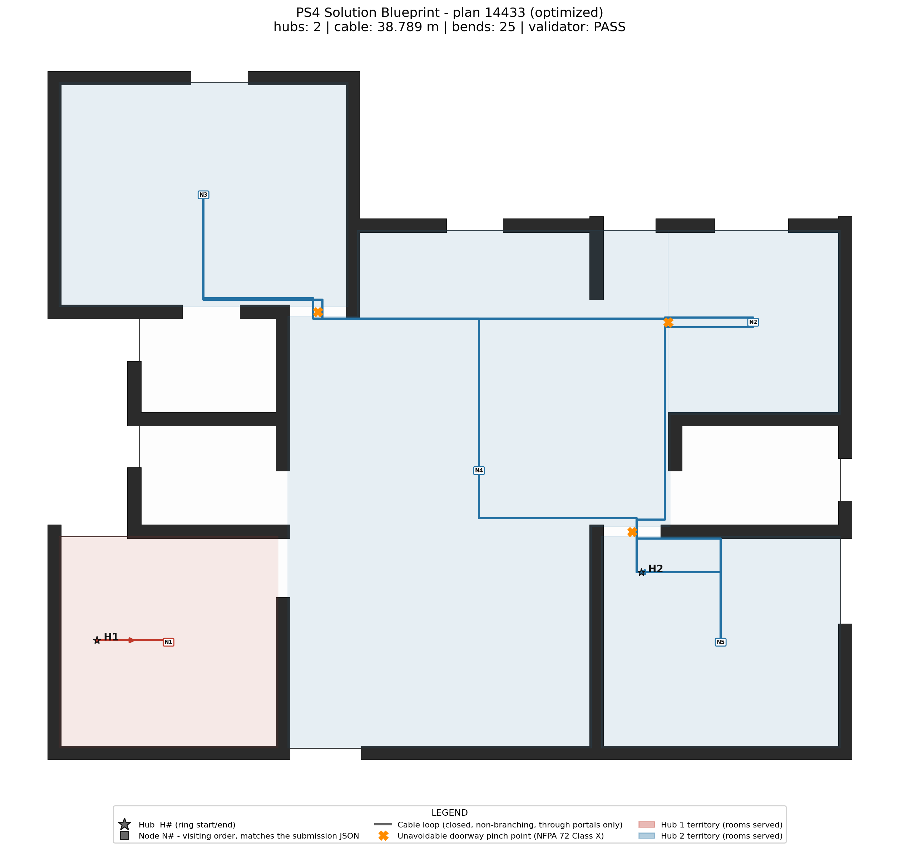
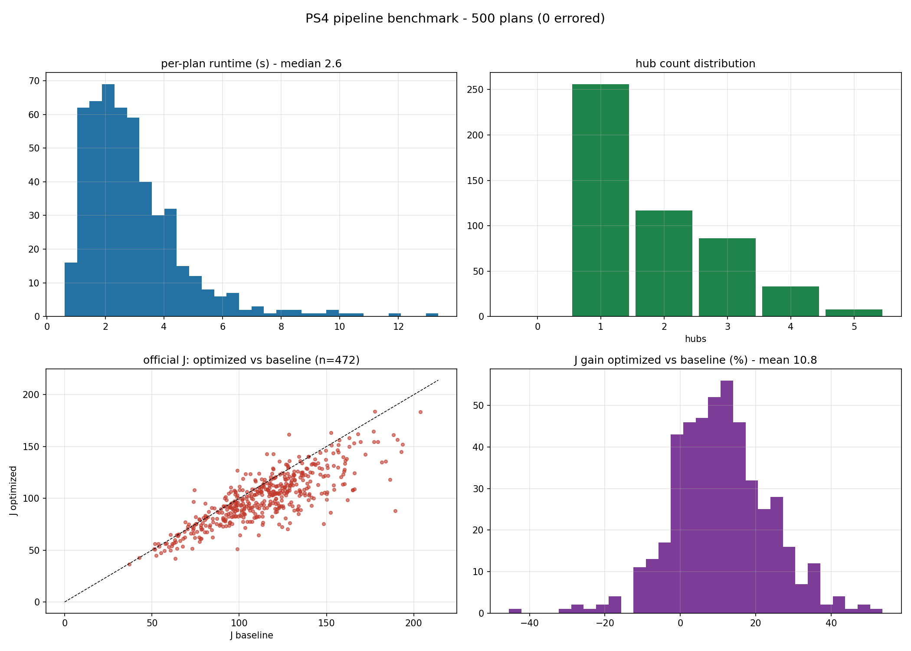

# HackHive PS4 — Hub Placement + Closed-Loop Fire-Alarm Cable Routing

Built for **Honeywell's HackHive Hackathon 2026** (48 hours, problem statement PS4):
given any ResPlan residential floor plan, decide how many fire-alarm control panels
("hubs") to place and where, which rooms each hub serves, and route one closed,
non-branching cable ring per hub — axis-aligned, through doors only, never through
walls or windows — while minimising the organisers' cost metric.

> **The pipeline was disqualified during the hackathon for routing cables diagonally.
> This repository is the honest story of that failure and the compliant rebuild that
> followed. Read the postmortem: [docs/POSTMORTEM.md](docs/POSTMORTEM.md).**



## The challenge

PS4 runs on [ResPlan](https://www.kaggle.com/datasets/resplan/resplan) — 17,000
residential floor plans delivered as room polygons in drawing units, wall/door/window
layers, and a room-adjacency graph. For every plan the system must decide:

1. **Hubs** — how many control panels and where each one goes,
2. **Zones** — which rooms and nodes each hub serves,
3. **Order** — the visiting sequence of each hub's nodes,
4. **Routes** — the physical cable path of every closed ring.

The hard rules (from the organisers' problem statement, kept verbatim in
[`docs/Cable Ring Challenge - Problem Statement4.pptx`](docs/Cable%20Ring%20Challenge%20-%20Problem%20Statement4.pptx)):

| # | Rule |
|---|---|
| 1 | One fixed node in **every** eligible room (living, bedroom, kitchen, storage); every room + node assigned to exactly one hub, never split |
| 2 | Each hub serves **≤ 100 m²** of eligible area **and** **≤ 5 nodes** (both at once) |
| 3 | Each hub's rooms form one **contiguous zone** connected through **doors / open passages only** (windows and wall-only adjacency don't count) |
| 4 | One **closed, non-branching ring** per hub: `H → N1 → … → Nn → H`, each node exactly once; retracing a door to reach a single-door room is allowed, shared line length counts as overlap |
| 5 | Cable runs **only horizontally or vertically**, inside the inner boundary, outside walls/windows, between rooms only through door/open-passage gaps |
| 6 | The hub point sits inside a room it serves, **≥ 0.5 m from walls** |

Plans are ranked **fewest hubs first**, then by cost **J = L + 5X + O + 0.5B**
(cable length at 1/m, crossings at 5 each, same-line overlap at 1/m, 90° bends at
0.5 each; 1 mm tolerance). Raw coordinates are converted to metres with the mandated
scale `sqrt(inner.area / plan["area"])` — `net_area` is never used (it is 0 in 32%
of plans). Deliverables per plan: a visual overlay (zones, hub/node IDs, visiting
order, rings, violations in red) and a JSON in the organisers' exact schema.

## What we built

A **two-tier pipeline**. Tier 1 pays the geometry bill once per plan; Tier 2 does
fast combinatorics on top of it. An independent validator re-derives geometry from
the raw plan and re-checks every rule; a CAD-style renderer produces the blueprint
overlay; a Flask app demos it in the browser.

```
raw plan (ResPlan.pkl)
        │
        ▼
┌─────────────────────────── Tier 1 — geometry (once per plan) ───────────────────────────┐
│ geometry.py   scale calibration, room extraction, geometrically verified portals        │
│               (door/open-passage gaps only), wall-hugging orthogonal raceway graph,     │
│               hub-candidate insets (0.6 m, fallback down to the 0.5 m minimum)          │
│ matrices.py   all-pairs shortest paths over that graph → D (metres) and B (bend counts) │
└──────────────────────────────────────────────────────────────────────────────────────────┘
        │  report: portals, pins, raceways, D, B
        ▼
┌─────────────────────────── Tier 2 — combinatorics (fast) ───────────────────────────────┐
│ optimize.py   capacity-feasible contiguous partitioning (BFS region-growing + boundary  │
│               swaps), dual-candidate ring sequencing (exact TSP ≤ 5 nodes / 2-opt),     │
│               each candidate scored on official J of its actual geometry,               │
│               Loop-First / Panel-Snap hub placement; baseline vs optimized modes        │
└──────────────────────────────────────────────────────────────────────────────────────────┘
        │  solution
        ▼
┌─────────────────────────── Trust but verify ────────────────────────────────────────────┐
│ validate.py   independent validator: re-derives geometry from the raw plan and checks   │
│               coverage, capacity, contiguity, ring shape, axis alignment, portal-only   │
│               room transitions, hub clearance ≥ 0.5 m                                   │
│ render.py     CAD-style blueprint: zones, H#/N# badges, visiting order, loop arrows,    │
│               doorway pinch points, violations in red                                   │
└──────────────────────────────────────────────────────────────────────────────────────────┘
        │
        ▼
scoring.py (official J from polylines)  ·  export.py (organisers' schema)  ·  demo.py (Flask UI)
```

### Module map

Implementation lives in the [`hackhive_ps4/`](hackhive_ps4/) package; the root-level
scripts (`run_pipeline.py`, `module2/3/4_*.py`, `compute_cost.py`,
`export_submission.py`, `app.py`) are thin backwards-compatible CLI wrappers.

| Module | What it does |
|---|---|
| [`hackhive_ps4/config.py`](hackhive_ps4/config.py) | Constants + dataset paths |
| [`hackhive_ps4/data.py`](hackhive_ps4/data.py) | Dataset loading, plan dict ↔ JSON round trip |
| [`hackhive_ps4/geometry.py`](hackhive_ps4/geometry.py) | Portal verification, scale calibration, axis-aligned routing graph |
| [`hackhive_ps4/matrices.py`](hackhive_ps4/matrices.py) | APSP D/B matrix build (Tier 1) |
| [`hackhive_ps4/optimize.py`](hackhive_ps4/optimize.py) | Partitioning + exact/J-aware ring sequencing (Tier 2) |
| [`hackhive_ps4/validate.py`](hackhive_ps4/validate.py) | Independent PS4-rule validator |
| [`hackhive_ps4/render.py`](hackhive_ps4/render.py) | Blueprint + quick-look PNGs |
| [`hackhive_ps4/scoring.py`](hackhive_ps4/scoring.py) | Official cost J = L + 5X + O + 0.5B |
| [`hackhive_ps4/export.py`](hackhive_ps4/export.py) | Organisers' submission-schema exporter |
| [`hackhive_ps4/pipeline.py`](hackhive_ps4/pipeline.py) | Batch runner |
| [`hackhive_ps4/demo.py`](hackhive_ps4/demo.py) | Flask demo UI |
| [`hackhive_ps4/synthetic.py`](hackhive_ps4/synthetic.py) | Synthetic rectilinear plans for tests/CI |

## Results

**500-plan benchmark** ([`benchmark/`](benchmark/), 5 worker processes, 307.5 s wall time):

| metric | value |
|---|---|
| pipeline completion | **500 / 500** (100%) |
| valid solutions | **474 / 500** (95.2%) — the 26 invalid are plans whose largest room exceeds the 100 m² cap under the mandated scale (officially unsolvable; organisers exclude such plans from benchmarks) or rooms the dataset gives no doorway for |
| runtime per plan (median / mean / max) | 2.55 / 2.94 / 13.36 s |
| official-J gain, optimized vs baseline (472 comparable) | **mean +10.8%, median +10.35%** |
| J wins / ties / losses | 390 / 13 / 69 (2 of the losses use *fewer* hubs than baseline — the official ranking puts hub count first) |



On the 24-plan submission batch ([`submissions/cost_summary.json`](submissions/cost_summary.json)):
mean J = 91.5, best plan 5616 at J = 62.4 (1 hub, 21.0 m of cable), all 24 passing
every hard rule with 0 diagonal segments (verified by [`check_axis_aligned.py`](check_axis_aligned.py)).

More blueprints: [plan 3796](docs/assets/blueprint_3796.png) (best J, 3 hubs,
18.99 m) · [plan 2372](docs/assets/blueprint_2372.png) (single-hub, 35.07 m) ·
showcase gallery in [docs/ASSETS.md](docs/ASSETS.md).

## Quickstart

```powershell
# 1. Install (Python 3.11+)
pip install -r requirements.txt

# 2. Get the dataset (not included in the repo)
#    Download ResPlan (archive.zip) and extract it so that ./dataset/ResPlan.pkl exists,
#    or set HACKHIVE_DATASET_DIR to wherever ResPlan.pkl lives.

# 3. Run the full pipeline on one plan (M2 router -> M3 optimizer -> M4 validator + blueprint)
python run_pipeline.py --plan-id 14433

#    ...or a batch smoke test
python run_pipeline.py --plan-id all --limit 25

# 4. Export the organisers' submission schema and score it with official J
python export_submission.py --all --limit 25     # -> submissions/<plan_id>.json
python compute_cost.py                           # -> submissions/cost_summary.json
python compute_cost.py --submission submissions/14433.json   # prints J for one file

# 5. Demo UI (no dataset needed if you upload a plan JSON)
python app.py                    # opens http://127.0.0.1:8000
python app.py --dump 14433 plan.json   # export one plan dict for offline upload

# 6. Tests / lint / types / benchmark
python -m pytest                 # 76 tests, 79% coverage
ruff check . && mypy hackhive_ps4
python benchmark/run_benchmark.py --plans 50 --workers 4
```

The demo UI runs the full pipeline in-process, shows the validated blueprint with
visitation order and legend, the baseline comparison, the validation checklist, and
a downloadable result JSON.

## Repository map

| Path | Contents |
|---|---|
| [`docs/POSTMORTEM.md`](docs/POSTMORTEM.md) | **The honest story**: what we built in 48h, why it was disqualified, the rebuild |
| [`docs/DESIGN.md`](docs/DESIGN.md) | Technical documentation: geometry pipeline, orthogonal routing, partitioning, validation, scoring |
| [`docs/ASSETS.md`](docs/ASSETS.md) | Showcase images with captions |
| [`docs/Cable Ring Challenge - Problem Statement4.pptx`](docs/Cable%20Ring%20Challenge%20-%20Problem%20Statement4.pptx) | The organisers' original problem statement |
| [`benchmark/`](benchmark/) | 500-plan benchmark harness, results.csv, summary.json |
| [`submissions/`](submissions/) | 24 verified submission JSONs + official cost J per plan |
| [`tests/`](tests/) | 76 tests (synthetic fixtures, bend counting, validator break-cases, scoring, golden-file export) |
| [`archive/`](archive/) | 31 early prototype scripts from the first hours, kept for the record |
| [`PROJECT_CONTEXT.md`](PROJECT_CONTEXT.md) | Agent-oriented project state log (the raw engineering diary) |

## License

[MIT](LICENSE)
