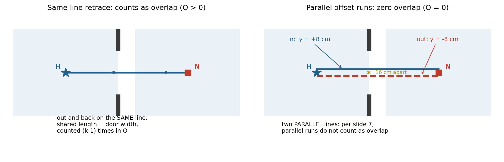

# Design notes

Technical documentation for the PS4 pipeline. Every module lives in
[`hackhive_ps4/`](../hackhive_ps4/); the root-level `run_pipeline.py`,
`module2/3/4_*.py`, `compute_cost.py`, `export_submission.py` and `app.py` are
thin CLI wrappers. Line references point into the package as of this writing.

For the story of *why* the code looks like this, read
[POSTMORTEM.md](POSTMORTEM.md). This file describes *what it does*.

## 1. Two-tier architecture

```
plan dict (ResPlan.pkl)
   │
   ├─ Tier 1 (once per plan, the expensive part)
   │    geometry.calibrate        scale: drawing units -> metres
   │    geometry.extract_rooms    eligible + transit rooms
   │    geometry.find_portals     geometrically verified door/open-passage portals
   │    geometry.build_global_graph  orthogonal raceway graph + portal crossings
   │    matrices.build_report     APSP over that graph: D (metres), B (bends)
   │
   ├─ Tier 2 (fast combinatorics on the matrices)
   │    optimize.find_partition   contiguous capacity-feasible territories
   │    optimize.solve_loop       dual-candidate ring sequencing (exact / 2-opt)
   │    optimize.best_panel_for_tour  Loop-First / Panel-Snap hub placement
   │
   └─ Trust but verify
        validate.validate         independent re-check of every PS4 rule
        render.render_blueprint   CAD-style overlay (also used by the demo UI)
        scoring.compute_metrics   official J from the polylines
        export.export             organisers' submission schema
```

## 2. Scale calibration (`geometry.calibrate`, geometry.py:97)

ResPlan coordinates are drawing units. The mandated conversion (organisers'
slide 4) is

```
scale_units_per_m = sqrt(plan["inner"].area / plan["area"])
```

computed once per plan before any limit or clearance check; `net_area` is never
used (it is 0 in 32% of plans). The median door width is still computed — but
only as a printed sanity cross-check (`area_implied_door_width_m`), never as the
scale. This is deliberate: an earlier build calibrated from a nominal 0.85 m
door width, which silently changed every area in the pipeline and masked plan
1448's 107.26 m² living room. See the postmortem, §3–4.

## 3. Portal verification (`geometry.find_portals`, geometry.py:236)

ResPlan's stored adjacency graph contains `fallback` and `via_window` edges that
are not physically trustworthy, and it *misses* some real passages. So portals
are decided geometrically:

- **Doors**: a door polygon is associated with both rooms by proximity (room
  polygons are separated by wall thickness), its long axis gives the opening
  axis, and `_door_opens_between` probes points on both sides of the door to
  confirm the two rooms lie on **opposite** sides — guarding against doors that
  merely touch two polygons at a corner junction.
- **Open passages**: wall-free spans of the shared boundary line between two
  room polygons, at least 0.6 m wide.
- **Sources**: graph edges of type `via_door` / `via_opening` *plus* every
  geometrically touching or wall-adjacent room pair (pass 2 catches missing
  graph edges).

Each portal gets two enter/exit **pins** per room, offset **±8 cm along the
opening axis** (see §9). Cable may only pass between rooms at portal crossings —
this is what makes "through doors only" true by construction rather than by
luck.

## 4. The routing graph (`geometry.build_local_graph`, geometry.py:419)

Per room, nodes are: the device point, portal pins, **raceway ring** vertices
(wall-hugging inset of the room interior, `raceway_ring` at geometry.py:169),
panel-candidate points, and **L-bend corner nodes**. All edges are axis-aligned
(official rule 5):

- node pairs that already share an x or y coordinate get a straight edge when
  the segment is covered by the room's free area;
- every other pair is connected via an L-shaped two-leg path through a bend
  node at the corner — both corner orientations are tried, and **both legs must
  be covered**, otherwise the pair gets no edge and Dijkstra routes around via
  other neighbours;
- bend nodes are deduplicated by position so many L-paths reuse the same
  rectification vertex;
- edge weights are true indoor metres (`length × scale`).

Rooms are stitched through portals in `build_global_graph` (geometry.py:548):
each pin pair across an opening gets an axis-aligned crossing edge — straight
when the pins share x or y, otherwise through an L-bend node inside the opening
polygon. The consequence of this design: **a diagonal cable segment is
unrepresentable**. The old build allowed straight-line edges between visible
points; the fix was not to filter diagonals afterwards but to make the graph
itself orthogonal.

## 5. The D/B matrices (`matrices.build_report`, matrices.py:32)

All-pairs shortest paths over the global routing graph from every device and
every panel candidate:

- **D[i][j]** — indoor cable length in metres along the routed path,
- **B[i][j]** — number of 90° bends along the same path.

Tier 2 then never touches geometry again: partition costs, ring lengths and
panel insertion costs are all table lookups on D and B. This is what makes the
500-plan benchmark average ~2.9 s per plan end-to-end.

## 6. Partitioning (`optimize.find_partition`, optimize.py:296)

- **Lower bound** `min_panels`: `max(ceil(total_area/100), ceil(nodes/5),
  #components)` — the organisers' own formula, plus one term per disconnected
  component (a disconnected component needs its own hub no matter what).
- **Region growing** (`grow_partition`): components are split by seeding BFS
  growth at a room and expanding through the *verified portal room graph*; every
  intermediate configuration where both sides are contiguous and fit both caps
  (100 m², 5 nodes) is a candidate, and the cheapest by total loop cable wins
  (bounded cost evaluations). Contiguity is strict: territories may traverse
  transit rooms but may never pass *through* another hub's rooms
  (`cluster_connected_strict`).
- **Boundary swaps** (`boundary_swap_improve`): a room moves to a neighbouring
  cluster only if both territories stay contiguous, caps hold, and the total
  loop cost strictly decreases.
- If no capacity-feasible contiguous partition exists (e.g. one oversized room),
  the best contiguous partition is returned with the violation **flagged, not
  hidden** — the validator then rules the plan invalid, as it should (see plan
  1448 in the postmortem).

## 7. Dual-candidate ring selection (`optimize.optimized_solution`, optimize.py:722)

Per cluster, two candidate visiting orders are generated:

- **Candidate A — exact**: exhaustive permutation search (`exact_tour`,
  optimize.py:197). The official 5-node cap keeps n ≤ 5, so at most 5! = 120
  candidates; code supports headroom to n = 8 (8! = 40320, still trivial).
  Provably length-optimal.
- **Candidate B — legacy**: nearest-neighbour + 2-opt on D
  (`legacy_tour`, optimize.py:222).

Both candidates get identical **Loop-First / Panel-Snap** treatment
(`best_panel_for_tour`, optimize.py:248): the panel candidate whose insertion
into the best tour edge adds the least cable is chosen, and the loop is rebuilt
with the panel inserted at that edge.

The winner is the candidate with the lower **official local J** of its *actual
stitched geometry* (`ring_local_j`, optimize.py:548) — implemented by reusing
`scoring.compute_metrics` on a single-hub pseudo-submission rather than
maintaining a second copy of the metric. Exact order wins ties.

Why both: the exact order is length-optimal but measured J on 7 of 24 batch
plans got *worse* with exact-only ordering — a shorter ring can cross itself
more, and X costs 5 each. Evaluating J on the real geometry of each candidate
keeps the best of both worlds: 6 plans improved, 18 unchanged, none worse, total
ΔJ = −53.3. Honest limitation (documented in the docstring): selection-time X/O
cover within-ring interactions only; inter-ring terms are plan-wide and computed
afterwards by `compute_cost.py`.

Partitioning costs still use the legacy tour, so partition decisions are
bit-identical to the pre-exact implementation.

Bends are counted on the **stitched loop polyline** (turn ≥ 45° at interior
vertices, `count_bends` at geometry.py:85) — summing per-segment B values misses
the turn at every segment junction.

## 8. Two modes

- **baseline** (`baseline_solution`): naive panel-first — greedy geometric
  clustering, panel nearest the cluster centroid, nearest-neighbour loop on
  straight-line device distances. A deliberate strawman to measure decision
  quality against.
- **optimized**: everything above.

Both modes are measured with the same true indoor routed lengths, so the
benchmark comparison isolates decision quality, not measurement differences.

## 9. The parallel-offset retrace trick

A single-door room forces the ring through the same doorway twice. A true
retrace runs out and back **on the same line**, and slide 7 counts same-line
overlap at 1 per metre: a stretch covered by k legs counts (k − 1) times its
length. But the organisers' slide 5 itself draws the sanctioned alternative —
"two parallel runs" — and slide 7 says explicitly: *"parallel runs on different
lines, O = 0"*.

So portal pins are offset **±8 cm along the opening axis** (`PORTAL_OFFSET_M =
0.08`, `portal_pins` at geometry.py:361). In and out become two parallel lines
16 cm apart: zero overlap by the metric's own definition, still physically sane.



Verified across all 137 portals of the 25-plan batch: zero overlap stretches lie
on a portal centreline, and the minimum pin separation is 0.1599 m — exactly the
designed 2 × 8 cm. The overlap J *does* count comes from different legs sharing
wall-raceway corridors away from doors — legitimate per the metric, and the top
remaining optimisation target (ring-wide edge-disjoint routing).

## 10. Validation (`validate.validate`, validate.py:67)

The validator re-derives geometry from the **raw plan** (its own calibration,
room extraction and portal pass) and checks the submitted solution against the
*spec's* numbers — not the builder's constants:

| check | what it proves |
|---|---|
| `assignment_complete` | every eligible room + node assigned to exactly one hub; no omissions, splits or duplicates |
| `capacity` | ≤ 100 m² eligible area and ≤ 5 nodes per hub |
| `contiguity` | each hub's rooms connected through verified portals only |
| `hub_clearance` | hub point inside an assigned room, ≥ **0.5 m** from walls (official rule 6; the *placement* uses a 0.6 m inset, the check enforces the official minimum) |
| `axis_aligned` | zero segments with both Δx and Δy non-zero |
| `closed_loops` | one closed non-branching ring per hub, every node exactly once |
| `physical_routes` | segments stay inside the inner boundary, never through walls or windows |
| `legal_transitions` | every room-to-room transition happens at a verified portal |

Any failure lists the violations (rendered in red on the blueprint). Honeywell
physics (NEC bend flags, 24 V voltage drop at 0.021 Ω/m for 18 AWG) is reported
alongside but is advisory, not part of PS4 validity.

**Design lesson baked into the architecture** (postmortem §3): during the
hackathon the validator shared the router's assumptions and certified the bug
along with the solution. The checks above are keyed to the organisers' numbers,
and the standalone axis gate (`check_axis_aligned.py`) inspects finished output
files without knowing how they were produced.

## 11. Scoring (`scoring.compute_metrics`, scoring.py:135)

Implements the official metric **J = L + 5X + O + 0.5B** (slide 6/7, 1 mm
tolerance) directly from submitted polylines:

- **L**: sum of all leg lengths, return legs included.
- **X**: points where two legs meet away from a node or hub — perpendicular
  crossings between axis-aligned segments, deduplicated within 1 mm, counted
  within a ring and between rings.
- **O**: for every shared infinite line, overlapping intervals are merged per
  leg and a stretch covered by k legs counts (k − 1) times its length.
  Retraces on the same line count; **parallel runs do not** (which is what §9
  exploits).
- **B**: direction changes along each closed ring at vertices, nodes and the
  hub; every turn is 90° by rule 5, a reversal counts once.

The same function is the acceptance test in Tier 2's dual-candidate selection —
one implementation of the metric everywhere, by construction.

## 12. Submission schema (`export.export`, export.py:114)

Emits the organisers' slide-8 schema per plan:

```json
{
  "plan_id": "...", "units": "m",
  "hubs": [{
    "hub_id": "H1", "room_id": "...",
    "location": {"x": ..., "y": ...},
    "assigned_rooms": [...], "assigned_nodes": [...],
    "closed_sequence": ["H1", "N1", "N3", "N2", "H1"],
    "route_segments": [
      {"from": "H1", "to": "N1", "length_m": 4.8,
       "polyline": [[5.2, 3.6], [7.6, 3.6], [7.6, 1.2]]}
    ],
    "ring_length_m": 23.8
  }],
  "reported_metrics": {"hub_count": 2, "total_length_m": 49.0}
}
```

Legs are split at the portal "pull points" (the exact in/out pin pairs) so each
`route_segment` is one leg; polylines are metres, origin lower-left, y up. The
exporter **parses its own output back** and re-verifies lengths, chain
connectivity and closed sequences before writing (`export.verify`) — trust the
file on disk, not the intention. The hub location is the ring's start point
(rather than an arbitrary candidate), which keeps re-anchoring artifacts out of
the rendered overlay.

Officially-unsolvable plans (largest room over 100 m² under the mandated scale)
and sealed rooms are refused with an explicit one-line reason instead of a fake
valid submission.

## 13. Tests, CI, benchmark

- **76 tests, 79% coverage** (`tests/`): synthetic rectilinear plans
  (`synthetic.py`), portal and bend-counting fixtures, validator break-cases
  (each check is asserted to *fail* on a deliberately broken solution), scoring
  metric unit tests, a golden-file export test, and an axis-alignment property
  test over generated routes.
- **CI** (`.github/workflows/ci.yml`): ruff, mypy (lenient), pytest with
  coverage, and a 3-plan synthetic smoke run that includes the axis gate —
  i.e. the original disqualification bug now fails CI in seconds.
- **Benchmark** (`benchmark/run_benchmark.py`): multiprocessing harness; the
  committed 500-plan run is summarised in `benchmark/summary.json`,
  `benchmark/benchmark.md` and per-plan in `benchmark/results.csv`.
